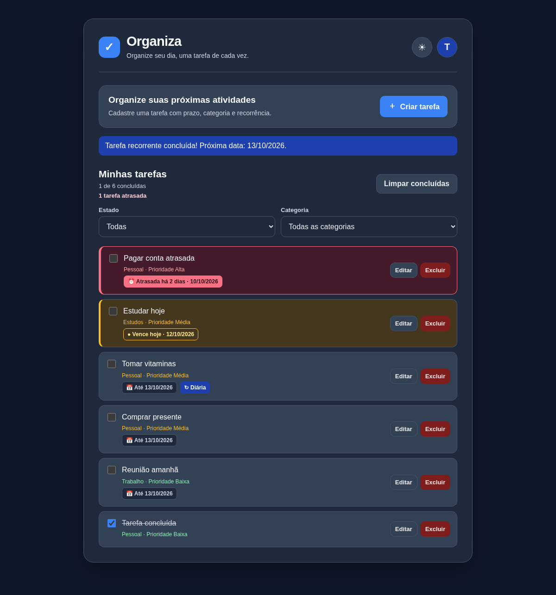

# Organiza ✅

**Suas tarefas, suas prioridades, sua rotina — tudo em um só lugar.**

Um aplicativo web responsivo para organizar tarefas pessoais, de trabalho e de estudos. Construído com **HTML, CSS e JavaScript**, com autenticação e armazenamento de tarefas no **Supabase (PostgreSQL)**.

### 🌐 [Acessar o Organiza online](https://organizadev.netlify.app/)

> **Teste agora:** abra o link, crie sua conta, confirme o e-mail (se solicitado) e comece a organizar suas tarefas. Não é necessário instalar nada para testar o site publicado.



*Captura ilustrativa da interface em desenvolvimento, com tarefas fictícias para demonstração.*

## ✨ Funcionalidades

- ✅ Cadastro, login, logout e recuperação de senha via Supabase Auth.
- 📝 Criação e edição de tarefas em um **modal**, sem poluir a tela principal.
- 🗂️ Categorias: **Pessoal**, **Trabalho** e **Estudos**.
- 🚩 Prioridades: baixa, média e alta.
- 📅 Prazo opcional com **data e horário**.
- ⏰ **Tarefas atrasadas em destaque**, com indicação do tempo de atraso e filtro específico.
- 🔁 **Recorrência** diária, semanal ou mensal, com reagendamento após a conclusão.
- 🔍 Filtros por estado e categoria.
- 👤 Perfil em modal com edição de nome e opção de sair da conta.
- 🌙 Modo escuro com transição suave e preferência salva no navegador.
- 📱 Layout responsivo para desktop e celular.
- ☁️ Tarefas sincronizadas pelo Supabase, separadas por usuário via **Row Level Security (RLS)**.

## 🛠️ Tecnologias

| Camada | Tecnologias |
| --- | --- |
| Interface | HTML5, CSS3 e JavaScript (sem framework) |
| Autenticação | Supabase Auth |
| Banco de dados | PostgreSQL, Supabase e RLS |
| Hospedagem | Netlify |
| E-mail transacional nos testes | SMTP configurado no painel do Supabase |

## 📁 Estrutura do projeto

```text
organiza/
├── site/                      # Arquivos publicados pelo Netlify
│   ├── index.html             # Login e cadastro (rota /)
│   ├── home.html              # Painel de tarefas (requer login)
│   ├── redefinir-senha.html   # Página de recuperação de senha
│   ├── login.html             # Rota antiga de login, mantida por compatibilidade
│   ├── style.css
│   ├── config.js              # URL e chave PÚBLICA do Supabase
│   ├── login.js
│   ├── script.js
│   └── redefinir-senha.js
├── supabase/sql/              # SQL para configurar um banco novo
├── docs/                      # Guia e prévia visual
├── scripts/                   # Verificação de arquivos do site
├── .github/workflows/         # Checagem automática de sintaxe e links
├── .gitignore
├── .editorconfig
├── netlify.toml
└── README.md
```

## ▶️ Como executar localmente

1. Faça download deste repositório (ou execute `git clone` depois de publicá-lo).
2. Abra a pasta `organiza` no **VS Code**.
3. Abra `site/index.html` com a extensão **Live Server** (ou outro servidor HTTP local).
4. Acesse o endereço que o Live Server informar. Ao entrar, a aplicação abre `home.html`.

O arquivo `site/config.js` contém a **URL e a publishable key públicas** do projeto de demonstração. Para conectar sua própria instância do Supabase, altere somente esses dois valores e configure seu banco seguindo [o guia de configuração](docs/CONFIGURACAO.md).

> ⚠️ **Segurança:** nunca coloque senha SMTP, senha do banco, `service_role`, `sb_secret_...` ou tokens de sessão dentro de `site/` ou em commits. A chave `sb_publishable_...` é pública por design; as políticas RLS são indispensáveis para proteger os dados.

## 🗄️ Supabase (para quem quiser hospedar sua própria cópia)

Em um **projeto novo**, execute no SQL Editor, nesta ordem:

1. `supabase/sql/01_criar_tabela_e_rls.sql`
2. `supabase/sql/02_adicionar_prazos_e_recorrencia.sql`
3. `supabase/sql/03_adicionar_horario.sql`

**Não reexecute o primeiro script no banco do Organiza já existente.** Os arquivos SQL são incluídos para documentar e reproduzir a estrutura. A recuperação de senha também requer configurar as URLs permitidas em **Authentication → URL Configuration** e um remetente SMTP em **Authentication → SMTP Settings**.

Veja [instruções completas de configuração e publicação](docs/CONFIGURACAO.md).

## 🚀 Deploy pelo GitHub no Netlify

Este repositório inclui `netlify.toml` com **Publish directory: `site`** e não precisa de build. Conecte o repositório ao seu site existente no Netlify para automatizar os próximos deploys.

Caso queira manter o deploy manual, também é possível enviar somente a pasta `site/` ao painel **Deploys** do Netlify. Não crie um novo site se deseja preservar o domínio atual.

**Site publicado:** [organizadev.netlify.app](https://organizadev.netlify.app/).

## 🔐 Sobre os dados

O aplicativo foi projetado para manter as tarefas de cada usuário separadas com autenticação e **RLS**. Antes de divulgar o projeto a outras pessoas, verifique as políticas do banco e faça testes usando duas contas diferentes. O SMTP Gmail é adequado para testes, mas não é a solução recomendada para um serviço público com muitos usuários.

## 📌 Próximas ideias

Notificações de prazos, pesquisa, indicadores de produtividade e melhorias de acessibilidade.

---

**Organiza** — um projeto de aprendizado em desenvolvimento web, com aplicação real publicada na internet.
